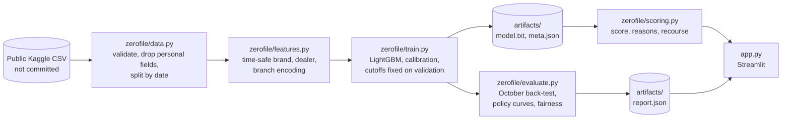

# ZeroFile

**A credit score for people with no credit file.**

[](https://neuralstorm.devpost.com/)


**Live demo:** LIVE_DEMO_URL · **Demo video:** DEMO_VIDEO_URL

| | |
|---|---|
| **Problem statement** | **HI-04: Alternative Credit Scoring for the Unbanked** |
| **Track and sub-theme** | Human Impact · FinTech Inclusion |
| **Team** | ZeroFile (solo entry) |
| **Member** | Aayush Sharma, BTech CSE (5th semester), Thapar University |
| **Event** | Neural Storm 2026, JNTUH Hyderabad. Built during the hackathon window, 2 to 4 November 2026 |

## Problem

A credit bureau score cannot rank someone it has never seen. In the public Indian vehicle-loan dataset used here, **116,950 of 233,154 borrowers (50.2%) have no bureau history at all.** A lender relying on the score alone has to turn all of them away or guess. Worldwide, about [1.3 billion adults still have no account](https://www.biia.com/financial-inclusion-at-record-high-but-1-3-billion-still-unbanked-world-bank-global-findex-2025-report) and so build no history in the first place.

## Solution

ZeroFile scores applicants from the loan application alone. It uses no bureau data, no ID documents, no age and no location, then does three things a bare score cannot:

1. **Explains every result.** A 300 to 900 score whose points add up exactly, factor by factor.
2. **Shows what would change it.** For example: "Put ₹5,500 more down and this application reaches the approve band."
3. **Shows a lender the consequences.** A slider that turns risk appetite into people approved, rupees unlocked and default rate on loans the model never trained on.

## Results

Tested on October 2018, a month the model never trained on. Cutoffs were **fixed on September data before October was scored**.

| What was measured (no-file applicants) | Result |
|---|---|
| Applicants approved | **21,288 of 49,748 (42.8%)** |
| Credit unlocked in one month | **₹107 crore** |
| Default rate among those approved | **16.1%** |
| Bureau low-risk borrowers (grades A to G), for comparison | 19.0% |
| Simple LTV rule approving the same number | 19.2% |
| All no-file applicants | 24.1% |
| AUC (95% bootstrap CI) | **0.631** (0.626 to 0.636) |
| KS statistic | 0.189 |
| Riskiest tenth against safest tenth | 40.0% against 11.2% default (3.6 times) |
| Brier score, against 0.183 from the base rate alone | 0.178 |
| Expected calibration error | 4.1% |
| Recall, precision and F1 (treating "not approved" as predicted default) | 71%, 30%, 0.42 |
| Scoring time per applicant | About 2 ms on a laptop CPU |

**It also out-ranks the bureau score where a score exists.** On borrowers with a real bureau grade, ZeroFile reaches AUC 0.609 against 0.589 for the bureau score itself (paired bootstrap gain 0.020, 95% CI 0.011 to 0.028). Full bureau data is still more powerful there, so ZeroFile is a way in for people with no file and not a bureau replacement.

### What each signal adds

| Model | AUC, no-file | AUC, bureau-rated | Lowest regional approval, as a share of the highest |
|---|---|---|---|
| Loan terms only | 0.588 | 0.566 | 21% |
| + employment type | 0.587 | 0.570 | 27% |
| **ZeroFile: + brand, dealer, branch** | **0.631** | **0.609** | **8%** |
| ZeroFile + ID documents (rejected) | 0.631 | 0.610 | 11% |
| ZeroFile + age and region (rejected) | 0.633 | 0.617 | 13% |
| ZeroFile + bureau data (comparison only) | 0.632 | 0.672 | 10% |

**Why AUC stays near 0.63:** the target is default on the first instalment, which is a noisy signal, and the bureau score itself only reaches 0.589 on the same test. The model separates groups well, but it cannot predict any single person.

### Bands

| Band | Share of no-file applicants | Default rate in October |
|---|---|---|
| Approve | 42.8% | 16.1% |
| Human review | 39.4% | 26.9% |
| High risk (a person reviews before any decline) | 17.8% | 37.0% |

## Fairness audit

Age and region are not model inputs, but other inputs can stand in for them, so the outcome is audited with the four-fifths rule.

| Group | Result |
|---|---|
| Age band | 4 of 4 pass |
| Employment type | 3 of 3 pass |
| **Region** | **5 of 18 pass** |

Region fails, and the app says so plainly. Dealer and branch records partly stand in for location. A **regional approval floor** (every region approves at least 34.2%, safest applicants first) adds 2,143 people and raises the default rate from 16.1% to 16.8%, still below the 19.0% benchmark. It lifts the lowest region from 8% to 49% of the highest, so the gap narrows but stays open. This is why ZeroFile sends borderline cases to a person and should never decline anyone on its own.

**ID documents were removed on purpose.** They add about 0.001 AUC, while an early version took about 33 points off an example applicant who gave a voter ID instead of Aadhaar. A score should not punish someone for which identity document they share.

## Screenshots

### Score an applicant


### Lender impact


### Evidence


### Fairness audit


## Architecture



The deployed app reads only `artifacts/`, so no borrower row ever reaches the host.

## How it works

- **Data:** 233,154 vehicle loans from August to October 2018. Date of birth, pincode, customer ID and employee code are dropped as the data loads.
- **Split by date, never randomly:** train on 111,622 loans (1 Aug to 23 Sep), tune on 23,168 (24 to 30 Sep), test on 98,364 (October). Default rates drift from 19.2% in September to 23.5% in October, so a random split would flatter the model.
- **Features (6):** loan-to-value, vehicle price, employment type, and the historic repayment records of the vehicle brand, dealer and branch. The records are smoothed, out-of-fold for training rows, and later months only see what training saw.
- **Model:** LightGBM with 152 trees. A monotonic constraint means a bigger loan against the same vehicle can never lower risk, which keeps recourse trustworthy. Platt scaling calibrates the output.
- **Score:** a linear map of the model's log-odds, where 100 points halve the odds of default. TreeSHAP values therefore add up exactly to the score.
- **Recourse:** the smallest change to the down payment or vehicle that reaches the approve band. Identity, dealer and age are never suggested.

## Tech stack

| Layer | Tools |
|---|---|
| Language | Python 3.11 |
| Model | LightGBM 4.7.0 (TreeSHAP through `pred_contrib`) |
| Data | pandas 3.1.0, NumPy 2.4.6 |
| Evaluation | scikit-learn 1.9.1 |
| App and charts | Streamlit 1.66.1, Altair 6.3.0 |
| Tests | pytest 9.2.0, Streamlit AppTest |
| Hosting | Streamlit Community Cloud (free) |

## Setup and running locally

You need Python 3.11. The trained model is in the repo, so the app runs without the dataset.

```bash
git clone https://github.com/Aayush657/zerofile-credit.git
cd zerofile-credit
python -m venv .venv
```

Activate the environment. On Windows:

```bash
.venv\Scripts\activate
```

On macOS or Linux:

```bash
source .venv/bin/activate
```

Install and run:

```bash
pip install -r requirements.txt
streamlit run app.py
```

The app opens at http://localhost:8501.

### Retrain and test

Training takes about 90 seconds on a laptop CPU. No GPU or API key is needed.

```bash
pip install -r requirements-dev.txt
python -m zerofile.data
python -m zerofile.train
pytest
```

`.env.example` lists the optional settings. Nothing in it is needed to run the app.

## Responsible use

- **A decision aid, not a decision.** It should send borderline cases to a person and never decline someone on its own.
- **Privacy.** The app stores nothing you type, and all example applicants are fictional. The repo holds a model and aggregate results, with no borrower rows.
- **Not financial advice.** This is a research prototype.

The full list of limits is in [MODEL_CARD.md](MODEL_CARD.md). The main ones:

- **It is a back-test.** Every row is a loan the lender funded, so results may not carry over to applicants it rejected.
- **Thin-file, not fully unbanked.** These are 2018 vehicle-loan borrowers with no bureau record. Most probably have bank accounts.
- **Risk estimates ran low.** Defaults jumped in late October beyond what the model expected, so a live system would need regular recalibration.
- **Not a fully blind test.** October was inspected while choosing features. Those choices only removed inputs, but a truly untouched test does not exist here.

## Data and licence

Data: [L&T Vehicle Loan Default Prediction](https://www.kaggle.com/datasets/mamtadhaker/lt-vehicle-loan-default-prediction) on Kaggle, uploaded by Mamta Dhaker. Its licence is listed as "Other" with no terms stated, so raw data is not redistributed here and `python -m zerofile.data` fetches it from the source. Code is under the [MIT licence](LICENSE).

## AI tools used

- **[Claude](https://www.anthropic.com/claude) by Anthropic (Claude Opus 5.5, through Claude Code):** researched the problem statements and datasets, ran the data experiments, and wrote the design, code, tests and documentation from my brief. I chose the problem from its shortlist and set the requirements.

## Future scope

- **Real alternative data:** cash-flow records through India's Account Aggregator framework, which could reach people without a vehicle-loan application.
- **Reject inference:** a controlled pilot on applicants who would otherwise be turned away, to test the back-test's biggest assumption.
- **Live monitoring:** drift alerts and scheduled recalibration, given the late-October jump.
- **Lender API:** a FastAPI scoring endpoint over the same `zerofile/scoring.py`.
- **Regional languages:** reasons and recourse in Hindi and other languages for the people who need them most.

## Repository layout

```text
app.py                 Streamlit app
zerofile/data.py       download, validation, time split
zerofile/features.py   features and target encoding
zerofile/train.py      end-to-end training run
zerofile/evaluate.py   metrics, policy curves, fairness audit
zerofile/scoring.py    score, reasons, recourse
artifacts/             trained model and aggregate report
tests/                 pytest suite, including headless app tests
docs/                  design, deployment guide, demo script, submission notes
MODEL_CARD.md          intended use and limits
```
