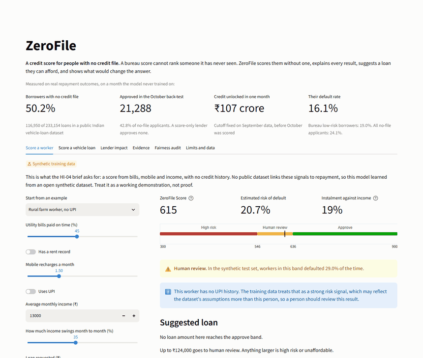
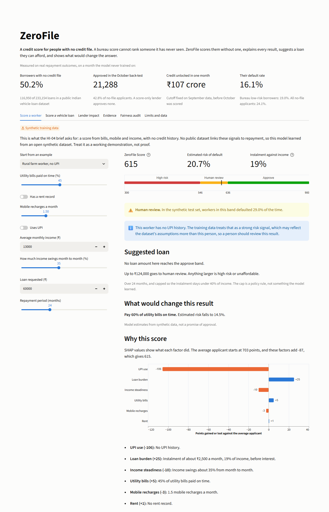
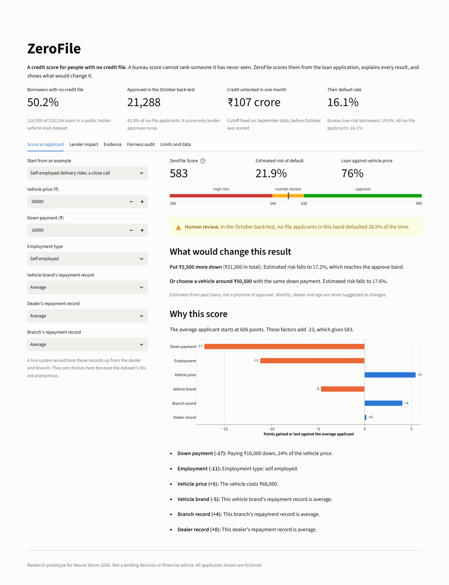
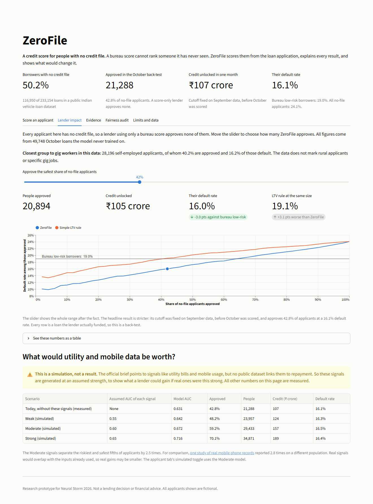
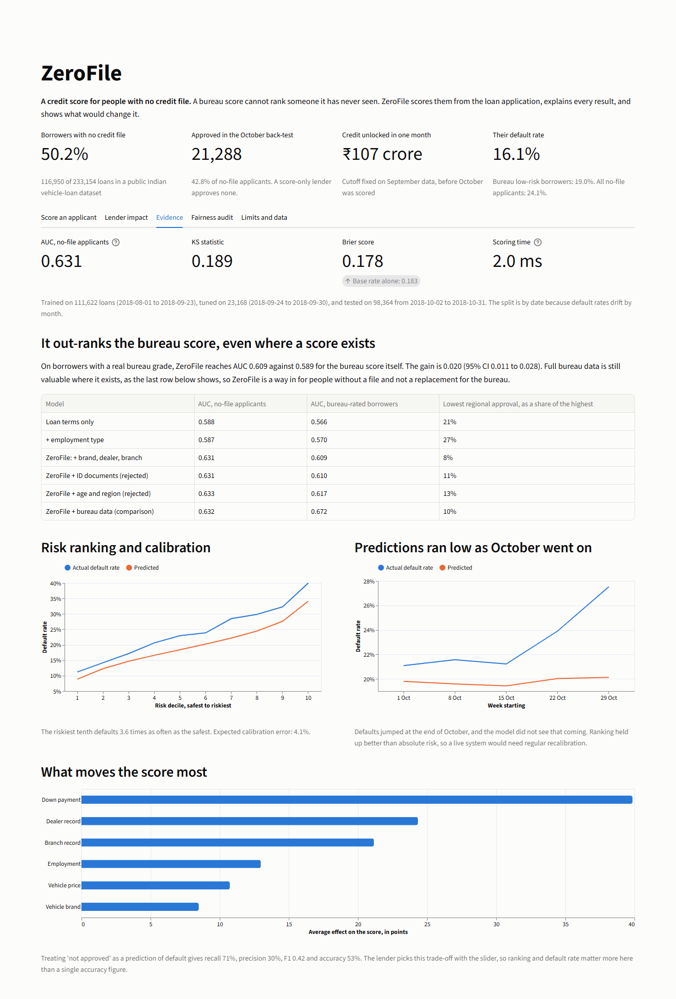
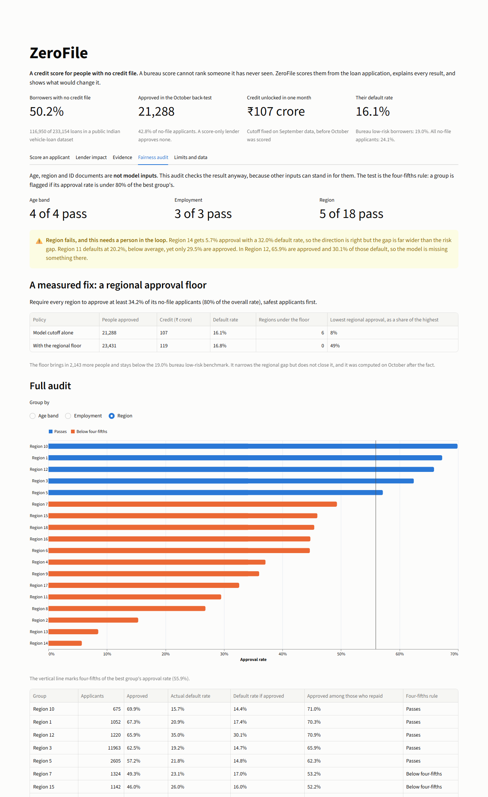
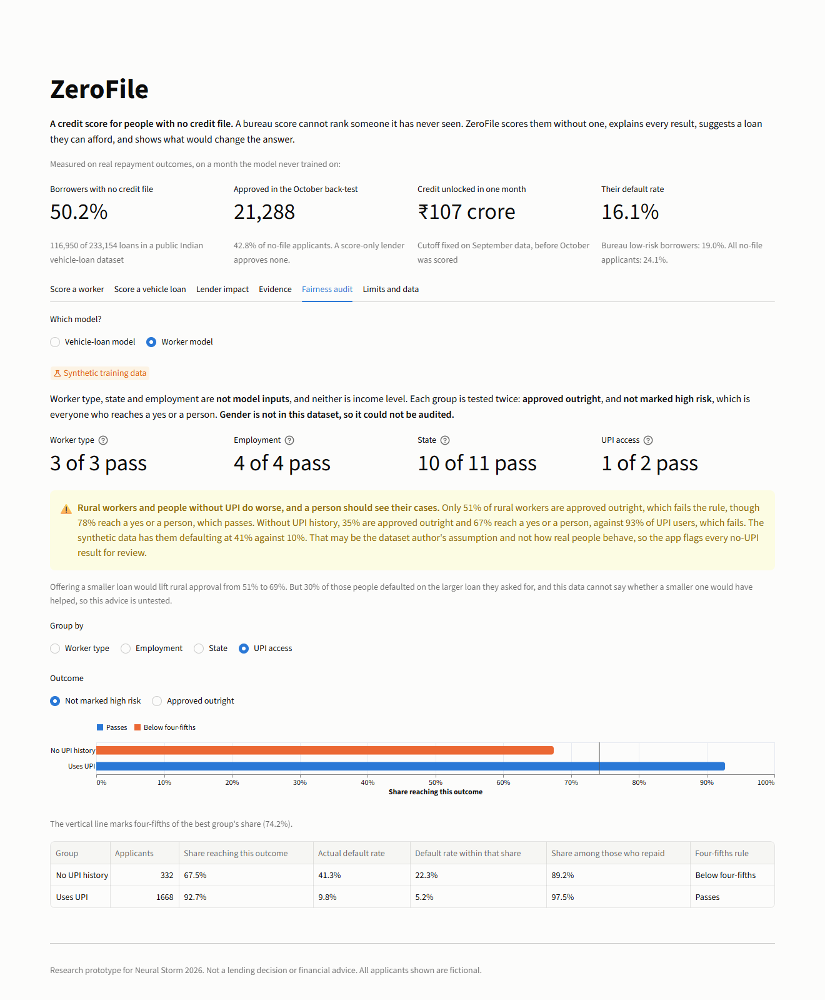
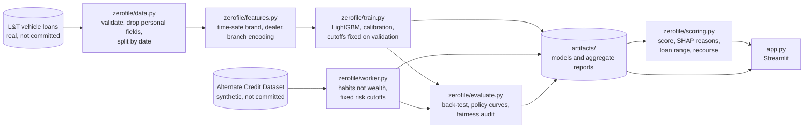

# ZeroFile

**A credit score for people with no credit file.**

[](https://github.com/Aayush657/zerofile-credit/actions/workflows/tests.yml)
[](https://neuralstorm.devpost.com/)


### [Try the live demo: zerofile.streamlit.app](https://zerofile.streamlit.app)

Free hosting, so if the app has been idle, press the wake-up button and give it a minute.



| | |
|---|---|
| **Problem statement** | **HI-04: Alternative Credit Scoring for the Unbanked** |
| **Track and sub-theme** | Human Impact · FinTech Inclusion |
| **Team** | ZeroFile (solo entry) |
| **Member** | Aayush Sharma, BTech CSE (5th semester), Thapar University |
| **Event** | Neural Storm 2026, JNTUH Hyderabad. Built during the hackathon window, 2 to 4 November 2026 |

## The 60-second version

**The problem.** A credit bureau score cannot rank someone it has never seen. In a public dataset of 233,154 Indian vehicle loans, **116,950 borrowers (50.2%) have no bureau history at all**. A lender relying on the score alone has to turn all of them away. Worldwide, about [1.3 billion adults have no account](https://www.biia.com/financial-inclusion-at-record-high-but-1-3-billion-still-unbanked-world-bank-global-findex-2025-report), so they build no history in the first place.

**What ZeroFile does.** It scores people with no credit file, explains every result with SHAP points that add up exactly, suggests a loan they can afford, and shows what would change the answer.

**The main result**, on real repayment outcomes from a month the model never trained on, with cutoffs fixed in advance:

| Applicants with no credit file | |
|---|---|
| Approved | **21,288 of 49,748 (42.8%)** |
| Credit unlocked in one month | **₹107 crore** |
| Their default rate | **16.1%** |
| Bureau low-risk borrowers (grades A to G), for comparison | 19.0% |

**Three things to try in the app:**

1. **Score a worker:** the rural farm worker has no UPI and lands in human review. Drag "Utility bills paid on time" to 60% and watch the band change.
2. **Lender impact:** move the slider and see people, rupees and default rate on real loans, then enter your own margin and loss to find the most profitable approval level.
3. **Fairness audit:** see where the model fails, stated plainly, and what a fix would cost.

## Two models, kept deliberately apart

The official brief points to utility bills and mobile usage, but no public dataset I could find links those records to repayment. So ZeroFile answers two separate questions, and the app labels every view with which one it is.

| | **Vehicle-loan model** | **Worker model** |
|---|---|---|
| **Question it answers** | Can non-bureau signals rank real borrowers? | How would a score from bills, mobile and income work? |
| **Data** | 233,154 real vehicle loans | 10,000 synthetic gig, rural and migrant borrowers |
| **Inputs** | Loan-to-value, vehicle price, employment type, and brand, dealer and branch repayment records | Bills and rent paid on time, mobile recharges, UPI use, income steadiness, loan burden |
| **AUC** | **0.631, measured** | 0.933, on synthetic labels |
| **What that number means** | Real predictive power | The model can learn the generator's rules, so it proves the pipeline and nothing more |

## How this answers the official brief

The brief is about people with no formal credit history, especially rural and gig workers: can signals like utility bills and mobile usage show whether they would repay? The official guide lets teams narrow or reinterpret a problem. This table shows where ZeroFile meets the brief and where it reinterprets it.

| The brief covers | What ZeroFile does | Evidence |
|---|---|---|
| Creditworthiness without formal credit history | Scores 49,748 no-file applicants against real repayment outcomes | **Measured** |
| Alternative data such as utility bills and mobile usage | The worker model runs on bills, rent, mobile recharges, UPI and income steadiness | **Synthetic, and labelled** |
| Rural and gig workers | The worker model covers gig, rural and migrant borrowers. In the real data, self-employed applicants are the closest group: 28,196 applicants, 40.2% approved, 16.2% default rate among them | **Synthetic, plus a real stand-in** |
| Fairness across gender, region and occupation | Region and occupation are audited in both models. Gender is in neither dataset | **Partly** |
| Explainable decisions | SHAP points breakdown and plain-language reasons on every result | **Built** |
| Score and limit advice | 300 to 900 score, and a suggested loan capped at 40% of income | **Built** |
| Privacy and consent | Personal fields dropped at load, nothing you type is stored, and consent is stated as a condition for alternative data | **Built** |

## Results: vehicle-loan model (real outcomes)

Trained on August and September 2018, and tested on October 2018. Cutoffs were **fixed on September data before October was scored**.

| What was measured (no-file applicants) | Result |
|---|---|
| Applicants approved | **21,288 of 49,748 (42.8%)** |
| Credit unlocked in one month | **₹107 crore** |
| Default rate among those approved | **16.1%** |
| Bureau low-risk borrowers, for comparison | 19.0% |
| Simple LTV rule approving the same number | 19.2% |
| All no-file applicants | 24.1% |
| AUC (95% bootstrap CI) | **0.631** (0.626 to 0.636) |
| Logistic regression on the same inputs | 0.626 |
| KS statistic | 0.189 |
| Riskiest tenth against safest tenth | 40.0% against 11.2% default (3.6 times) |
| Brier score, against 0.183 from the base rate alone | 0.178 |
| Expected calibration error | 4.1% |
| Recall, precision and F1 (treating "not approved" as predicted default) | 71%, 30%, 0.42 |
| Scoring time per applicant | About 2 ms on a laptop CPU |

**It also out-ranks the bureau score where a score exists.** On borrowers with a real bureau grade, ZeroFile reaches AUC 0.609 against 0.589 for the bureau score itself (paired bootstrap gain 0.020, 95% CI 0.011 to 0.028). Full bureau data is still more powerful there, so ZeroFile is a way in for people with no file and not a bureau replacement.

**Why AUC stays near 0.63.** The target is default on the first instalment, which is noisy. A scan of 32 LightGBM settings only moved the AUC between 0.629 and 0.631, and the bureau score itself reaches only 0.589 on the same test, so this looks like the limit of the data and not of the model. It separates groups well, but it cannot predict any single person.

### What each signal adds

| Model | AUC, no-file | AUC, bureau-rated | Lowest regional approval, as a share of the highest |
|---|---|---|---|
| Loan terms only | 0.588 | 0.566 | 21% |
| + employment type | 0.587 | 0.570 | 27% |
| **ZeroFile: + brand, dealer, branch** | **0.631** | **0.609** | **8%** |
| ZeroFile + ID documents (rejected) | 0.631 | 0.610 | 11% |
| ZeroFile + age and region (rejected) | 0.633 | 0.617 | 13% |
| ZeroFile + bureau data (comparison only) | 0.632 | 0.672 | 10% |

### Bands

| Band | Share of no-file applicants | Default rate in October |
|---|---|---|
| Approve | 42.8% | 16.1% |
| Human review | 39.4% | 26.9% |
| High risk (a person reviews before any decline) | 17.8% | 37.0% |

## Results: worker model (synthetic data)

**These numbers show the pipeline works. They do not show real-world accuracy.** In this dataset, a borrower counts as defaulted whenever a generated probability passes a fixed cutoff, so a model can learn the generator's rules. That probability column is the answer in disguise, so it is left out of training.

| Measure | Result |
|---|---|
| AUC on the test set (95% CI) | 0.933 (0.920 to 0.946) |
| AUC across 5 random splits | 0.922 to 0.934 |
| Logistic regression on the same inputs | 0.887 |
| Brier score, against 0.128 from the base rate alone | 0.068 |
| Expected calibration error | 1.1% |

| Band | Rule, fixed in advance | Share | Default rate in the test set |
|---|---|---|---|
| Approve | No riskier than the average borrower (15%) | 71.7% | 2.2% |
| Human review | In between | 16.9% | 29.0% |
| High risk | More likely to default than not (50%) | 11.5% | 74.7% |

### Which signals matter, and which were rejected

| Inputs | AUC |
|---|---|
| Utility bills and rent only | 0.834 |
| + mobile recharges | 0.840 |
| + UPI use | 0.908 |
| + income steadiness | 0.917 |
| **ZeroFile worker model: + loan burden** | **0.933** |
| + wealth stand-ins such as income level (rejected) | 0.930 |
| + job tenure, income sources, number age (rejected) | 0.934 |
| + survey and e-commerce (rejected) | 0.933 |
| + age, household, worker type, state (rejected) | 0.934 |
| Demographics alone | 0.673 |

The rejected inputs add almost nothing, and most of them invite bias. Leaving out income level means the model scores habits, not wealth, while income still sets how large a loan is affordable.

## Fairness audit

Age, region, worker type and ID documents are not inputs to either model, but other inputs can stand in for them, so outcomes are audited with the four-fifths rule. **Gender is not in either dataset, so it could not be audited.**

**Vehicle-loan model (real outcomes)**

| Group | Result |
|---|---|
| Age band | 4 of 4 pass |
| Employment type | 3 of 3 pass |
| **Region** | **5 of 18 pass** |

Region fails, and the app says so plainly. Dealer and branch records partly stand in for location. A **regional approval floor** (every region approves at least 34.2%, safest applicants first) adds 2,143 people and raises the default rate from 16.1% to 16.8%, still below the 19.0% benchmark. It lifts the lowest region from 8% to 49% of the highest, so the gap narrows but stays open.

**Worker model (synthetic data)**

| Group | Approved outright | Reach a yes or a person |
|---|---|---|
| Gig workers | 80% | 92% |
| Migrant workers | 82% | 94% |
| Rural workers | 51% (fails) | 78% (passes) |
| Uses UPI | 79% | 93% |
| No UPI history | 35% (fails) | 67% (fails) |

Half of rural borrowers in this data have no UPI, and it is the strongest signal in the model. The data has them defaulting at 41% against 10%, but that may be the dataset author's assumption and not how real people behave. **So every no-UPI result is flagged for a person.**

Offering a smaller loan would lift rural approval from 51% to 69%, but 30% of those people defaulted on the larger loan they asked for, and this data cannot say whether a smaller one would have helped. That advice is untested.

**Removed on purpose:** ID documents add about 0.001 AUC, while an early version took about 33 points off an example applicant who gave a voter ID instead of Aadhaar. A score should not punish someone for which identity document they share.

All of this is why ZeroFile sends borderline cases to a person and should never decline anyone on its own.

## What would utility and mobile data add to real loans?

**This is a simulation, not a result.** It adds generated signals to the real loans at an assumed strength, to size what a lender could gain before paying for such data.

| Scenario | Assumed AUC of each signal | Model AUC | Approved | People | Credit | Default rate |
|---|---|---|---|---|---|---|
| Today, without these signals (measured) | None | 0.631 | 42.8% | 21,288 | ₹107 crore | 16.1% |
| Weak (simulated) | 0.55 | 0.642 | 48.2% | 23,957 | ₹124 crore | 16.3% |
| Moderate (simulated) | 0.60 | 0.672 | 59.2% | 29,433 | ₹157 crore | 16.5% |
| Strong (simulated) | 0.65 | 0.716 | 70.1% | 34,871 | ₹189 crore | 16.4% |

The Moderate signals separate the riskiest and safest fifths of applicants by 2.5 times. For comparison, [a study of real mobile phone records](https://arxiv.org/abs/1712.05840v3) reported 2.8 times on a different population, so that scenario is not far-fetched. Real signals would overlap with the inputs already used, so real gains may be smaller.

## Screenshots

### Score a worker


### Score a vehicle loan


### Lender impact


### Evidence


### Fairness audit




## Architecture



The deployed app reads only `artifacts/`, so no borrower row ever reaches the host.

## How it works

- **Split by date, never randomly (real data):** train on 111,622 loans (1 Aug to 23 Sep), tune on 23,168 (24 to 30 Sep), test on 98,364 (October). Default rates drift from 19.2% in September to 23.5% in October, so a random split would flatter the model. The synthetic data has no dates, so it uses a stratified 60/20/20 split, repeated five times to check stability.
- **No leakage:** brand, dealer and branch records are smoothed and out-of-fold for training rows, and later months only see what training saw. Date of birth, pincode, customer ID and employee code are dropped as the data loads.
- **Models:** LightGBM with Platt calibration. Monotonic constraints mean a bigger loan can never lower risk and a better payment record can never raise it, which keeps recourse trustworthy.
- **Score:** a linear map of the model's log-odds, so TreeSHAP values add up exactly to the score. On the vehicle-loan scale, 100 points halve the odds of default.
- **Loan range:** the largest loan that stays in each band. The monotonic constraints make that limit well defined, and on the worker model an explicit policy rule also caps the instalment at 40% of income, because the synthetic labels barely punish oversized loans.
- **Recourse:** the smallest change to the down payment, vehicle, loan size or bill record that reaches the approve band. Identity, dealer and age are never suggested.
- **Lender economics:** you enter a margin and a loss rate, and the app finds the most profitable approval level. Those two numbers are assumptions, and everything else comes from the real back-test.

## Tech stack

| Layer | Tools |
|---|---|
| Language | Python 3.11 |
| Models | LightGBM 4.7.0 (TreeSHAP through `pred_contrib`) |
| Data | pandas 3.1.0, NumPy 2.4.6 |
| Evaluation | scikit-learn 1.9.1 |
| App and charts | Streamlit 1.66.1, Altair 6.3.0 |
| Tests and CI | pytest 9.2.0, Streamlit AppTest, GitHub Actions |
| Hosting | Streamlit Community Cloud (free) |

## Setup and running locally

You need Python 3.11. The trained models are in the repo, so the app runs without any dataset.

```bash
git clone https://github.com/Aayush657/zerofile-credit.git
cd zerofile-credit
python -m venv .venv
```

Activate the environment. On Windows:

```bash
.venv\Scripts\activate
```

On macOS or Linux:

```bash
source .venv/bin/activate
```

Install and run:

```bash
pip install -r requirements.txt
streamlit run app.py
```

The app opens at http://localhost:8501.

### Retrain and test

Everything trains in a few minutes on a laptop CPU. No GPU or API key is needed, and the results are reproducible.

```bash
pip install -r requirements-dev.txt
python -m zerofile.data
python -m zerofile.train
python -m zerofile.worker
python -m zerofile.tune
pytest
```

`.env.example` lists the optional settings. Nothing in it is needed to run the app.

## Responsible use

- **A decision aid, not a decision.** It should send borderline cases to a person and never decline someone on its own.
- **Privacy and consent.** The app stores nothing you type, and all example applicants are fictional. The repo holds models and aggregate results, with no borrower rows. A live system should use utility and mobile records only with the applicant's consent.
- **Not financial advice.** This is a research prototype.

The full list of limits is in [MODEL_CARD.md](MODEL_CARD.md). The main ones:

- **The worker model's data is synthetic.** It shows how such a score would work, and proves nothing about real accuracy. Its risk gaps by region and UPI access are the dataset author's assumptions.
- **The real results are a back-test.** Every row is a loan the lender funded, so results may not carry over to applicants it rejected.
- **Thin-file, not fully unbanked.** The real data covers 2018 vehicle-loan borrowers with no bureau record. Most probably have bank accounts, and rural applicants and gig jobs are not marked.
- **Gender could not be audited.** Neither dataset includes it.
- **Risk estimates ran low.** Defaults jumped in late October beyond what the model expected, so a live system would need regular recalibration.
- **Not a fully blind test.** October was inspected while choosing features. Those choices only removed inputs, but a truly untouched test does not exist here.

## Data and licence

- **Real data:** [L&T Vehicle Loan Default Prediction](https://www.kaggle.com/datasets/mamtadhaker/lt-vehicle-loan-default-prediction) on Kaggle, uploaded by Mamta Dhaker. Its licence is listed as "Other" with no terms stated, so raw data is not redistributed, and `python -m zerofile.data` fetches it from the source.
- **Synthetic data:** [Alternate Credit Dataset](https://www.kaggle.com/datasets/shreyyans/alternate-credit-dataset) on Kaggle by Shreyans, under the MIT licence. The official guide suggests synthetic data modelled on utility and mobile usage.
- **Not used:** the official guide also suggests Home Credit Default Risk, but [Kaggle's rules for that competition](https://www.kaggle.com/competitions/home-credit-default-risk/rules) limit its data to the competition itself.
- **Code:** [MIT licence](LICENSE).

## AI tools used

- **[Claude](https://www.anthropic.com/claude) by Anthropic (Claude Opus 5.5, through Claude Code):** researched the problem statements and datasets, ran the data experiments, and wrote the design, code, tests and documentation from my brief. I chose the problem from its shortlist and set the requirements.

## Future scope

- **Real alternative data:** a consented pilot with utility and telecom partners, or cash-flow records through India's Account Aggregator framework, to replace the synthetic data with measurement and audit gender.
- **Reject inference:** a controlled pilot on applicants who would otherwise be turned away, to test the back-test's biggest assumption.
- **Live monitoring:** drift alerts and scheduled recalibration, given the late-October jump.
- **Lender API:** a FastAPI scoring endpoint over the same `zerofile/scoring.py`.
- **Regional languages:** reasons and recourse in Hindi and other languages for the people who need them most.

## Repository layout

```text
app.py                 Streamlit app
zerofile/data.py       download, validation, time split
zerofile/features.py   vehicle-loan features and target encoding
zerofile/train.py      vehicle-loan training run
zerofile/worker.py     worker model: data, training, audit
zerofile/altdata.py    simulated signals for the data-value table
zerofile/tune.py       settings scan that shows the data's limit
zerofile/evaluate.py   metrics, policy curves, fairness audit
zerofile/scoring.py    score, reasons, loan range, recourse for both models
artifacts/             trained models and aggregate reports
tests/                 pytest suite, including headless app tests
docs/                  design, deployment guide, demo script, submission notes
MODEL_CARD.md          intended use and limits
```
